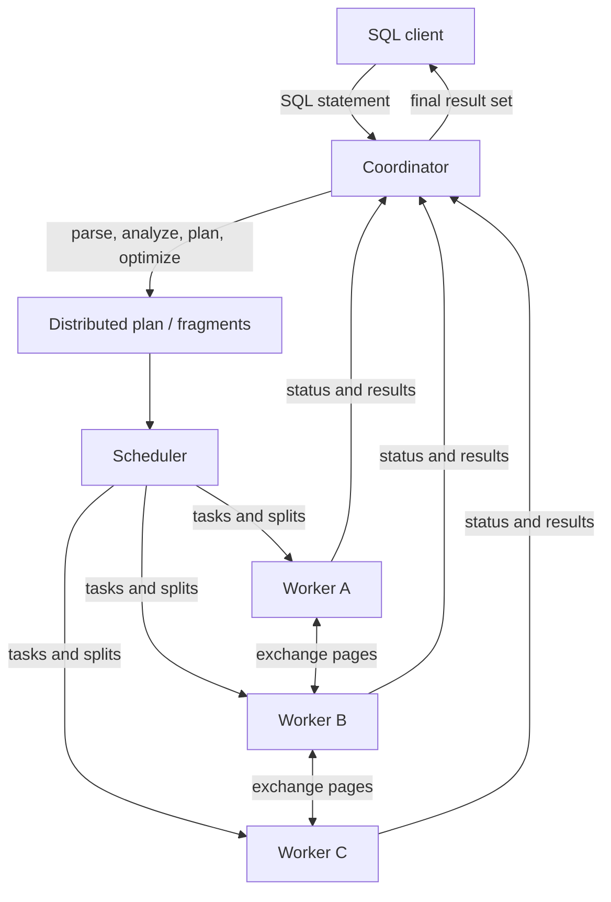
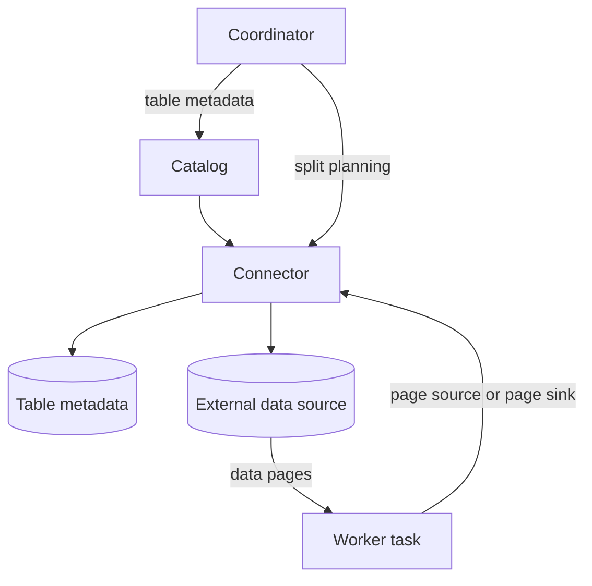
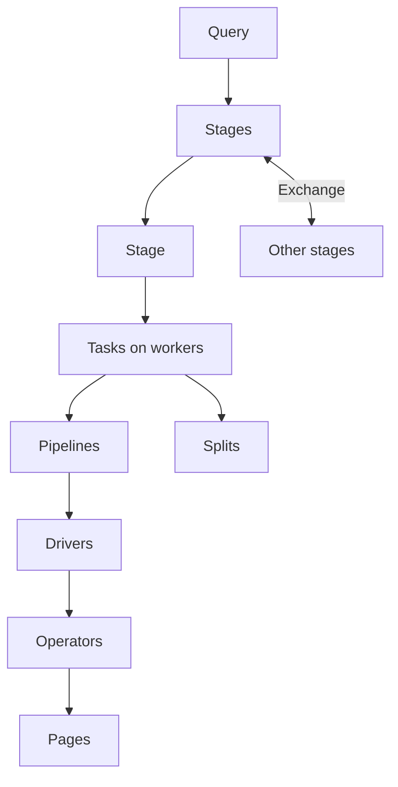

<link rel="stylesheet" href="https://cdn.jsdelivr.net/npm/katex@0.16.2/dist/katex.min.css" integrity="sha384-bYdxxUwYipFNohQlHt0bjN/LCpueqWz13HufFEV1SUatKs1cm4L6fFgCi1jT643X" crossorigin="anonymous">


A lot of what makes Trino hard to pick up is vocabulary: coordinator, worker,
catalog, connector, split, stage, task, driver, operator, page, block.


What has worked for me is to follow one query through the system and keep asking
the same question:


```text
Which part plans the work, which part runs the work, and where does the data
move next?
```


Before tracing a real query, it helps to have the runtime map in place: which
objects exist, where planning stops, where execution starts, and how data moves
between them. That map is what this note covers.


## The Small Example


We will use this query as the running example:


```sql
SELECT o_orderstatus, count(*)
FROM iceberg.tpch.orders
WHERE o_orderdate >= DATE '1995-01-01'
GROUP BY o_orderstatus;
```


The table name has three parts:


```text
iceberg.tpch.orders
```


Read it as:


```text
catalog.schema.table
```


The catalog tells Trino which connector to use. In this example, the `iceberg`
catalog routes table access to the Iceberg connector. The connector is the
boundary between Trino’s query engine and the external data source.


At a high level, the query moves like this:


```text
SQL client
  -> coordinator
  -> parser
  -> analyzer
  -> planner
  -> optimizer
  -> distributed plan
  -> scheduler
  -> workers
  -> connector page source
  -> data source
  -> Trino pages
  -> operators
  -> coordinator
  -> SQL client
```


Most of that path falls on one side of a single division:


```text
coordinator:
  decides what work should happen

workers:
  execute the work and move data through operators
```


## Why MPP Matters Here


Trino is an MPP query engine. MPP means massively parallel processing: one SQL
query can be split into many pieces of work and executed across multiple workers
at the same time.


For this note, that comes down to four roles:


```text
coordinator:
  plans and schedules the query

workers:
  run pieces of the query in parallel

exchanges:
  move intermediate pages between stages

final result:
  returns to the client through the coordinator
```


Stage, task, split, driver, operator, and exchange all exist because of this.
They are how one SQL query runs as distributed work instead of as one local
process reading everything by itself.


## Architecture


The first diagram shows the control and data paths between the client, the
coordinator, and the workers:





The same query also crosses a connector boundary, shown in the second diagram:





The coordinator is the control plane for a query. It accepts SQL, analyzes it,
creates plans, asks connectors for metadata, schedules tasks on workers, and
tracks query state.


Workers are the execution plane. They receive tasks, read data through
connectors, run operators such as scan/filter/join/aggregation, exchange
intermediate data with other workers, and report progress back to the
coordinator.


Connectors let Trino query systems outside the engine. Iceberg, Hive, JDBC,
Kafka, TPCH, and Memory are all connector-backed access paths. For lakehouse
tables, a lot of the interesting behavior lives in the connector: metadata lookup,
predicate pushdown, partition pruning, split generation, statistics, and file
reading.


## Query Lifecycle


A normal read query goes through these steps:


```text
1. Client submits SQL.
2. Coordinator parses SQL into an abstract syntax tree.
3. Analyzer resolves catalogs, schemas, tables, columns, types, and functions.
4. Planner creates a logical plan.
5. Optimizer rewrites the plan.
6. Distributed planner splits the plan into stages and fragments.
7. Scheduler assigns tasks and splits to workers.
8. Workers execute operators.
9. Exchanges move intermediate data between stages.
10. Final results stream back to the client.
```


In `EXPLAIN` output, Trino prints fragments. For this mental model, I treat a
fragment as the planned distributed unit that becomes stage work during
execution.


The list is dense, but it sorts cleanly along the control/data split:


```text
before execution:
  mostly coordinator work

during execution:
  workers run pipelines and exchange data

at connector boundaries:
  Trino asks the connector about tables, columns, splits, page sources, and
  writes
```


## The Runtime Hierarchy


Once a query is running, its work is organized in this hierarchy:


```text
Query
  -> stages
     -> tasks
        -> pipelines
           -> drivers
              -> operators
                 -> pages
```


The same hierarchy as a diagram, with splits and exchanges added:





The table below gives a one-line meaning for each term.


| Concept  | Short meaning                                                                     |
| -------- | --------------------------------------------------------------------------------- |
| Query    | The full SQL statement being executed.                                            |
| Stage    | A distributed piece of the query plan. Stages are connected by exchanges.         |
| Task     | A stage fragment running on one worker.                                           |
| Pipeline | A chain of operators that can move data page by page.                             |
| Driver   | One running copy of a pipeline.                                                   |
| Operator | A step that scans, filters, joins, aggregates, sorts, exchanges, or outputs data. |
| Page     | A columnar batch of rows passed between operators.                                |
| Split    | A unit of table-scan work, often a file or file range for lakehouse tables.       |


Splits feed source operators. They are not a level below every task in the same
way drivers and operators are; they are the scan work that a source task
processes.


I found it easier to learn this hierarchy first and the class names later.


## Stage And Task


A stage is a distributed piece of the query plan. For example, a query might
have:


```text
source stage:
  scan table data and apply local filters

aggregation stage:
  combine rows by group key

root stage:
  produce the final result
```


A task is one stage fragment running on one worker.


If a source stage needs to scan many files, Trino can create tasks on multiple
workers. Those tasks process splits in parallel. The coordinator decides where
tasks and splits should go; workers execute the local work they receive.


A common mistake is to think of a stage as a worker. A stage is part of the
plan; a task is that stage’s work running on a worker.


## Split


A split is a unit of work for reading data. For file-based lakehouse tables, a
split often maps to a file or byte range, for example:


```text
orders/file_001.parquet, bytes 0-134217728
orders/file_002.parquet, bytes 0-67108864
orders/file_003.parquet, bytes 67108864-134217728
```


The exact meaning depends on the connector. Trino’s engine understands that it
has splits to schedule; the connector understands what those splits mean for the
underlying system.


In practice, the Trino scheduler assigns work to workers, but the Iceberg
connector decides which data files belong to a snapshot and how to turn
them into Iceberg splits.


## Pipeline, Driver, And Operator


Inside a task, Trino builds pipelines. A pipeline is an operator chain.


For a simple scan and filter, the pipeline might look like:


```text
TableScan -> FilterAndProject -> TaskOutput
```


For an aggregation stage, it might look like:


```text
ExchangeSource -> HashAggregation -> PartitionedOutput
```


A driver is one running copy of a pipeline. If the pipeline is the recipe, a
driver is one active execution of that recipe.


An operator is one step inside the driver. The ones we will see most often are:


```text
TableScanOperator:
  reads pages from a connector page source

FilterAndProjectOperator:
  filters rows and computes expressions

HashAggregationOperator:
  groups rows and maintains aggregation state

TaskOutputOperator / PartitionedOutputOperator:
  sends pages onward
```


The driver coordinates the operators. During processing, it repeatedly pulls
pages from one operator and pushes them into the next:


```text
current.getOutput() -> Page
next.addInput(Page)
```


For our example query, a source pipeline might do this:


```text
read a Page from the Iceberg/Parquet page source
  -> keep rows where o_orderdate >= DATE '1995-01-01'
  -> keep or compute the columns needed by the query
  -> send pages into an aggregation or exchange path
```


The data moves in batches, not as individual Java objects for each SQL row.


## Page And Block


A Trino `Page` is an in-memory batch of rows in columnar form. Conceptually, it
looks like this:


```text
Page
  positionCount = 3

  Block 0: o_orderkey
    [101, 102, 103]

  Block 1: o_orderstatus
    ["O", "F", "O"]
```


Each logical row is a position across blocks:


```text
position 0 -> 101, "O"
position 1 -> 102, "F"
position 2 -> 103, "O"
```


Four terms describe this layout:


| Term     | Meaning                            |
| -------- | ---------------------------------- |
| Page     | A batch of rows.                   |
| Block    | One column’s values inside a page. |
| Position | Row index inside the page.         |
| Channel  | Column index inside the page.      |


This is what people mean when they say Trino processes columnar batches
internally. Operators pass `Page` objects to each other, and each page contains
one `Block` per output column.


A Trino page is not the same thing as a Parquet page:


```text
Trino Page:
  in-memory execution batch

Parquet page:
  encoded and usually compressed storage unit inside a Parquet column chunk
```


The names overlap, but they belong to different layers.


## Connector Boundary


The connector boundary is where Trino stops being only a query engine and starts
talking to an external system.


Our example reads from:


```sql
FROM iceberg.tpch.orders
```


Trino uses the `iceberg` catalog. The Iceberg connector is responsible for
Iceberg-specific work such as:


```text
finding the table
reading table metadata
choosing a snapshot
applying predicate and projection pushdown
planning splits
creating page sources for the table's data files, such as Parquet, ORC, or Avro
```


The engine still owns the general query pipeline:


```text
parse SQL
analyze names and types
build and optimize plan
schedule work
run operators
exchange pages
produce final results
```


Knowing which side of the boundary something is on answers a lot of questions
later. If a filter is pushed
into Iceberg, that is connector behavior. If a stage exchanges pages between
workers, that is engine execution behavior.


## Coordinator Scheduling vs Worker Execution


There are two scheduling layers:


```text
coordinator scheduler:
  decides which workers receive tasks and splits

worker-local task executor:
  decides which local driver or split runner gets a thread next
```


The coordinator does not step through every operator itself. It places work on
workers and tracks progress. After that, each worker has local execution
queues and runs its assigned work.


Inside a worker execution turn, a driver streams pages through its operator
chain:


```text
TableScan.getOutput() -> Page
FilterAndProject.addInput(Page)
FilterAndProject.getOutput() -> filtered Page
TaskOutput.addInput(filtered Page)
```


If the driver yields or blocks, the same live driver/operator objects keep their
state. Already-produced pages may have moved into an output buffer, local
exchange, or another stage.


## What This Means For EXPLAIN


A small set of `EXPLAIN` plan terms map back to the runtime model above:


```text
TableScan or ScanFilterProject:
  where data enters from a connector

Exchange / RemoteSource:
  where pages move between stages

Aggregation / Join / Sort:
  where operators transform pages

Fragment / Stage:
  how Trino splits the query into distributed pieces

Estimates:
  planner guesses, not runtime proof
```


`EXPLAIN` shows the planned shape. `EXPLAIN ANALYZE` runs the query and adds
runtime measurements. Detailed plan reading belongs in the next note.


When I later run:


```sql
EXPLAIN
SELECT o_orderstatus, count(*)
FROM iceberg.tpch.orders
WHERE o_orderdate >= DATE '1995-01-01'
GROUP BY o_orderstatus;
```


I want to map each plan section back to the hierarchy:


```text
Which connector is used?
Where is the scan?
Where are filters applied?
Where does aggregation happen?
Where do exchanges happen?
Which fragment produces the final result?
```


Answering these against a real plan is where the vocabulary starts to stick.


## Self-Check


Questions to check later:

1. What does the coordinator do before workers read data?
1. What is the difference between a stage and a task?
1. What is a split?
1. What is the relationship between a pipeline and a driver?
1. What does an operator consume and produce?
1. What is a Trino `Page`?
1. Why is a Trino page different from a Parquet page?
1. What work belongs to the connector instead of the core engine?
1. Why is `catalog.schema.table` important?
1. Why is `EXPLAIN ANALYZE` different from `EXPLAIN`?

## References

- Trino concepts: https://trino.io/docs/current/overview/concepts.html
- Trino `EXPLAIN`: https://trino.io/docs/current/sql/explain.html
- Trino SPI overview: https://trino.io/docs/current/develop/spi-overview.html
